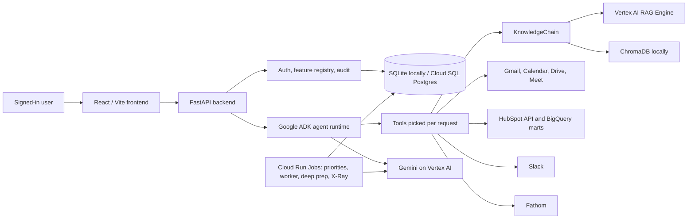

# Cubie

**Cubie, by RubikSoft**, is an AI copilot for the people of a company. It reads
what they already work in (email, calendar, meetings, Slack, Drive, HubSpot and
the company's documents), decides what matters, and brings it to them: the
morning briefing, the priorities, the follow-ups they owe, the meeting prep and
the CRM updates are waiting before anyone thinks to ask. People open the app
to drill down, ask a question or approve a change.

Cubie never sends client email or changes the CRM on its own. It drafts, and a
person approves. The one exception is a link: when someone runs Customer X-Ray
research on a company, Cubie stamps that company's HubSpot record with a link
back to the research (the `cubie_research_link` field), once the field exists.

## What it does

Every user-facing feature ships open to everyone signed in with the company's
domain. Manager views, exec roll-ups and admin pages ship to the matching role.
Admins narrow or widen any feature by department, with no release, in
**Admin → Feature Access** (the registry is `rubik_core/features/registry.py`).
Some features also have a server switch (an env "kill switch") that decides
whether they run at all; Feature Access shows its live state.

### The copilot (everyone)

- **Daily Briefing and AI Priorities.** The home page leads with what needs the
  person today, ranked overnight from their email, calendar, meeting
  transcripts, HubSpot, Slack, labelled Drive documents and EOS items, weighed
  against the company's Rocks and goals. Cards can be marked done, dismissed,
  snoozed, turned into a focus block or acted on. Fridays add a look at next
  week; time off holds the list and prompts a hand-off.
- **Morning Slack DM.** The top priorities each weekday, for the departments an
  admin enrolls in Admin → AI Priorities, plus the Exec team.
- **What's On Your Plate.** The briefing answers "what is waiting on me?":
  replies owed and awaited, requests nobody answered, and commitments whose date
  has stopped being believable because the other side went quiet.
- **Promise follow-through.** Cubie hears what a person says they will do in
  meetings, L10s, sent email and Slack, and once the date passes with no sign it
  happened, puts it in their briefing in their own words. Nothing is marked
  done on its own.
- **Ask Cubie (Chat).** Plain-language questions across company documents, the
  product catalog, live HubSpot, the person's Gmail, calendar, meeting
  transcripts and Slack, who is out, the web and Cubie's own Help, with sources.
  It drafts email to Gmail Drafts only.
- **Files in Ask Cubie.** Attach a document, spreadsheet, deck or picture and
  ask about it. The file goes into the person's own private library; nobody
  else can see it.
- **Meeting Skills.** Any meeting in the shape you ask for ("my 10am as a BANT
  note"), every point quoting the transcript. Save it as a template or a
  `/skill`, or run it after every meeting.
- **Voice input and voice commands.** A microphone in the chat box, and a Voice
  button and shortcut on every page: open a page or record, ask a question, or
  make an EOS change, each confirmed on a card first. Recordings are never
  stored.
- **Productivity.** Full-page Email (bulk mail hidden), Calendar, Slack,
  Documents (recent Drive files) and Team Folders.
- **Assets.** The shared document library Chat answers from, with versions and
  restore, plus the meeting transcripts the person attended.
- **Meeting Prep and Deep Prep.** A versioned briefing for an upcoming meeting,
  built in the background: HubSpot, the latest Customer X-Ray, past meetings,
  open to-dos and, for outside guests, public professional background. Exports
  to Word, PDF and Assets. Deep Prep is a more thorough review, emailed as a PDF.
- **My To-Dos.** What the person promised, for whom and by when, added on the
  page, from Chat, from Slack `/todo` or from a priority card, with the promises
  Cubie heard waiting in a tray to accept.
- **Scheduled tasks.** Recurring Cubie work set up in Chat (a morning email
  round-up, a Monday recap) delivered to a chat folder and a Slack DM. Runs read
  and draft; they never send email for the person.
- **Cubie for Chrome.** A new-tab page with the promises past due and this
  morning's priorities, each one click from the right page.
- **What's New, page tours and Help.** Release notes RubikSoft writes once,
  short tours on each page, and a Help center mirrored into Chat.

### Sales

- **Customer X-Ray.** Account health, churn risk, a relationship timeline and
  growth plays for a customer in seconds, or an emailed Deep Research PDF. Each
  run links back from the client's HubSpot company record.
- **Sales Call Capture (Today's Calls).** The day's client calls, transcription
  switched on where Google allows it, the product checklist on screen, and a
  wrap-up that proposes HubSpot updates (fields, leads, tasks) for approval.
  Fathom-recorded calls are picked up too.
- **Cubie in Google Meet.** The same call checklist in Meet's side panel.
- **Call Scripts.** Per-product checklists of what a call must surface, written
  and approved by the people who own each product.
- **Proposal Generator.** A one-page client proposal from a confirmed brief, as
  a branded PDF or Word draft, in one of the company's own templates. Prices
  come only from what the AE confirmed or the company's catalog.
- **CRM Sync.** Proposed HubSpot contact and deal updates from the person's own
  call transcripts, approved one card at a time.
- **Sales Cockpit.** My Day for an AE (wrap-ups waiting, new leads, pipeline
  hygiene, deals against a clock, no contact in 90 days), a Team Roll-up for a
  manager, a Nudge Worklist for the delivery team and an Exec Roll-up with
  counts only. Deals can be deferred to a follow-up date.
- **Sales daily rhythm.** Morning, mid-day and end-of-day checks on each rep's
  own deals, in Ask Cubie and on My Day, with a team version for leaders.
- **Loose Ends.** Every weekday Cubie checks each AE's email and Slack against
  HubSpot: client conversations never logged, clients waiting on a reply, and
  promises or tasks past their date. Each row has one real next step and clears
  itself when the work is done. Leaders get a team view and an optional daily
  Slack post.
- **Weekly close-date roll-up.** One Slack message a week naming the deals whose
  close date is hardest to believe.

### Teams and EOS

- **Smart Teams.** The Work Style Interview, a private profile, a "How to work
  with me" guide published only by its owner, comparisons, self-confirmed skills
  and a Team Builder. Advisory only; never used for performance decisions.
- **Handoffs.** When an admin offboards someone, their open work becomes a
  handoff brief and checklist for a named successor.
- **EOS.** VTO, Scorecard, Rocks, To-Dos and Issues, live L10 meetings with a
  recap email, Slack `/todo` and `/ids`, Processes and an EOS dashboard. Exec
  team items stay with the Exec team. (Phase 2 makes EOS a module each
  workspace switches on.)

### For admins and leaders

- **Feature Access**, **AI Cost** (spend per AI feature), **Chat** and **Sales
  Models** (which model powers what, with no release), **AI Priorities** tuning
  and playbooks, **Loose Ends** daily post, users, roles, departments, Drive
  labels, folders, L10 meetings, login activity and feedback.
- **Company setup.** The company profile prompts read ("what we sell, to whom"),
  the product and service catalog (CSV upload) and the proposal templates. All
  start empty; features say plainly what is missing and where to add it.
- **Insights.** Adoption and value dashboards, with a people view for leaders.
- **Viewing Cubie as a person.** Named admins can view one person's Cubie,
  read-only, with every session logged.

### What Cubie does not do

- It never sends email to clients. Replies, follow-ups and proposals land as
  Gmail drafts or downloads. The messages it sends itself are internal: the L10
  recap, the morning DM, the roll-ups and digests, and reports a person asked
  for.
- It changes HubSpot only when a person approves the change or presses the
  button that makes it. The one automatic write is the Customer X-Ray link on
  the company record.
- It does not write SOWs or contract language.

## Architecture

One deployable web service: the React SPA is built into `frontend/dist`,
copied into the Python image and served by FastAPI. Background work runs as
Cloud Run Jobs from the same image. Locally the frontend and backend run
separately.



| Layer | Main paths | Responsibilities |
| --- | --- | --- |
| Frontend | `frontend/src` | Pages, tours, Help, brand tokens (`src/brand/`) |
| API | `backend/main.py`, `backend/routers/*` | Routes (copilot routers mount on the `core` parent), health, SPA serving |
| Auth and access | `backend/auth.py`, `rubik_core/auth/`, `rubik_core/features/` | Google sign-in, mock sign-in for local work, roles, the feature registry |
| Agent runtime | `rubik_core/adk_agent/`, `rubik_core/agent_runtime/`, `rubik_core/orchestration/` | Routing, policy, tools, confirmations |
| Retrieval and ingestion | `rubik_core/retrieval/`, `rubik_core/rag/`, `rubik_core/ingestion/` | RAG, HubSpot and BigQuery, meeting transcripts |
| Features | `rubik_core/<feature>/` | Priorities, meeting prep, X-Ray, call capture, cockpit, Loose Ends, Smart Teams, EOS and the rest |
| Company data | `rubik_core/company/`, `rubik_core/brand.py` | Company profile, catalog, the product and vendor names |
| Persistence | `rubik_core/database/`, `alembic/` | Models and migrations |

Engineering rules and lessons that every change must respect are in
[`docs/ENGINEERING_NOTES.md`](docs/ENGINEERING_NOTES.md); the project rules for
contributors (human or AI) are in [`CLAUDE.md`](CLAUDE.md).

## Local quickstart

Prerequisites: Python 3.10, Node.js 22 or newer.

**Two-workspace local preview** (from the repo root):

```bash
python3.10 -m venv .venv
.venv/bin/pip install -r requirements.txt
npm --prefix frontend ci
scripts/dev/up.sh
```

This migrates one local control database and separate RubikSoft and Acme
databases, seeds defaults and first admins, then starts the API and Vite.
Open `http://127.0.0.1:5173/login` and select **Enter local preview**. The
default account is `dev@acme.example`. For a request from the other workspace,
send `X-Mock-User: dev@rubik-soft.com` with `Authorization: Bearer mock-token`.
`scripts/dev/up.sh --setup-only` is idempotent and starts no servers;
`--reset` replaces only its default gitignored local demo data.

**Signing in locally.** With no Google client id configured, the development
login page offers **Enter local preview**. The button checks that the local
backend accepts mock authentication before signing in as `CUBIE_DEV_USER_EMAIL`
(default `dev@acme.example`). The local setup provisions domains and admins.
Mock sign-in skips automatic transcript sync. Local preview also blocks manual
and scheduled transcript sweeps and skips historical sync when creating a user.
Features keyed to the company's domain use that workspace's
verified primary domain. The AI Priorities batches, their
Slack DM, the Loose Ends scan and the CRM Sync sweep never read a mailbox on a
reserved `*.example` or `*.local` name, so a local run makes no Workspace calls
for the default identity.

Mock sign-in never runs when `APP_MODE=gcp`.

## Configuration

Settings live in `rubik_core/config.py`; `.env.example` lists the ones a
deployment sets. Nothing company-specific has a default: no domain, admin,
project id, portal id, pipeline or field name is in the code.

| Variable | Purpose |
| --- | --- |
| `APP_MODE` | `local`, `dev_mock_auth` or `gcp` |
| `ENABLE_MOCK_AUTH` | Mock sign-in outside `gcp` mode |
| `CUBIE_DEV_USER_EMAIL` | Who mock sign-in uses when no mock user is named (default `dev@acme.example`); use an address on a provisioned workspace domain |
| `GOOGLE_CLIENT_ID` | Google sign-in; verified domains and module flags live in the control database |
| `GOOGLE_WORKSPACE_SERVICE_ACCOUNT_KEY`, `ADMIN_EMAIL` | Domain-wide delegation credential and its subject |
| `DATABASE_URL` | Local database (SQLite) |
| `CLOUDSQL_CONNECTION_NAME`, `DB_USER`, `DB_PASS`, `DB_NAME` | Cloud SQL |
| `GCP_PROJECT_ID`, `GCP_REGION`, `GCS_BUCKET_NAME` | Google Cloud project, region and bucket |
| `VERTEX_LLM_MODEL_LITE`, `_FLASH`, `_PRO`, `VERTEX_LLM_LOCATION` | Gemini model tiers |
| `VERTEX_RAG_CORPUS_ID`, `VERTEX_RAG_LOCATION` | The knowledge corpus |
| `BIGQUERY_PROJECT_ID`, `BIGQUERY_DATASET` | HubSpot analytics marts |
| Workspace connector secret bindings | Bind HubSpot read/write tokens to this workspace's control connector; runtime does not use process-wide company tokens. |
| Admin → Workspace → HubSpot settings | Each workspace sets its own portal id, allowed pipelines, won stages, custom properties, Call Capture vendor fields, Sales rhythm and stage lag stages, and Scorecard sync mapping. Empty pipelines block deal reads and writes. |
| Admin → Access → Google Workspace → Workspace operations | Each company sets its business time zone, ingestion health audience, Insights exclusions, Loose Ends Scorecard metric, delivery sender details and L10 recap start date. An unset L10 start date blocks recap delivery. Person-impersonation grants are platform managed. |
| `COCKPIT_BUSINESS_DAY_HOURS` | Global length of a business day for Cockpit SLAs; its local clock comes from the workspace control row. |
| Workspace connector secret bindings | Fathom API/webhook secrets and Slack installation credentials belong to the workspace. Missing bindings refuse inbound events. |
| `SCHEDULER_API_KEY` | The key Cloud Scheduler sends to job endpoints |
| `FRONTEND_URL` | The app's public origin (links in email, Slack and HubSpot) |
| `CUBIE_DEPLOY_FREEZE` | An optional weekly window in which no deploy starts |
| `<FEATURE>_ENABLED` | Per-feature kill switches (see Feature Access) |

## Tests and checks

CI (`.github/workflows/python-app.yml`) runs ruff, the single-Alembic-head check,
the migrations on SQLite, the backend suite and, in a second job, the frontend
tests and build. Locally, with the CI environment:

```bash
export APP_MODE=dev_mock_auth DATABASE_URL=sqlite:///./test.db \
  CLOUDSQL_CONNECTION_NAME="" DB_USER="" GCP_PROJECT_ID=mock-project PYTHONPATH=.
.venv/bin/ruff check . && .venv/bin/ruff format --check .
rm -f test.db && .venv/bin/alembic upgrade head
.venv/bin/pytest -n 8 -q
(cd frontend && npm test && npm run build && npm run lint)
```

- The backend suite runs under pytest-xdist. Each worker copies the
  Alembic-built `test.db` to its own `test_<worker>.db` before any engine
  exists (root `conftest.py`), so workers never share a SQLite file. The copies
  are gitignored (`test_*.db`).
- `backend/tests/test_no_legacy_brand.py` scans for any trace of the code's
  previous owner. It is a hard gate: one hit fails the suite.
- Frontend tests use `node --test` (Node 22 or newer runs the TypeScript
  directly); `npm run build` type-checks them.

## Deployment

Nothing deploys from CI. `scripts/platform/bootstrap_gcp.sh` provisions a new
platform, `scripts/platform/deploy.sh` applies a checked release, and
`scripts/platform/workspace.sh` provisions workspaces. Each takes an explicit
private environment file and supports a dry run. Every deploy checks all
workspace freeze windows, including the 20-minute lead. See
[`docs/GO_LIVE.md`](docs/GO_LIVE.md) for the ordered go-live checklist,
[`docs/migrations_guide.md`](docs/migrations_guide.md) for migrations and
[`docs/deployment_rollback.md`](docs/deployment_rollback.md) for rollback.

## Roadmap

The design is [`docs/superpowers/specs/2026-10-27-cubie-platform-design.md`](docs/superpowers/specs/2026-10-27-cubie-platform-design.md):

1. **Rebrand and clean-up** (this phase).
2. **Workspaces:** a database per client company, a control database, routing
   by sign-in domain, and one-command deploy and provisioning.
3. **Connectors and setup:** a Connectors page (Google Workspace, Slack,
   HubSpot, Fathom, custom MCP servers) and a new-workspace wizard.
4. **Sales Coach add-on.**

---

Cubie is a product of RubikSoft. Support and questions:
[jose.leon@rubik-soft.com](mailto:jose.leon@rubik-soft.com).
